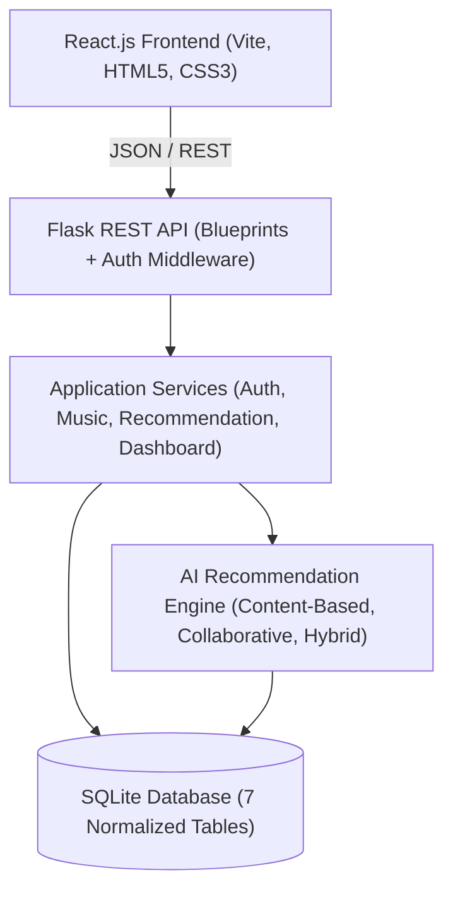
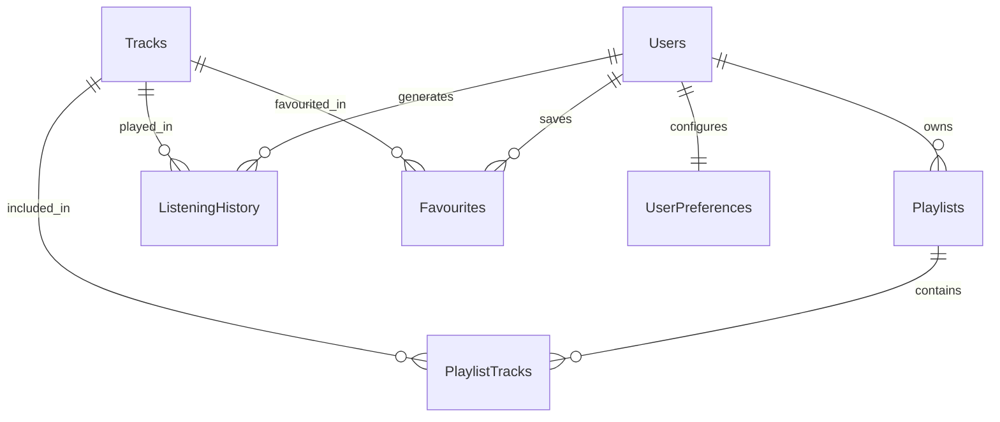

# System Architecture, ER Diagram & Agile Plan — TuneTrail

## 1. Layered System Architecture

## 2. Entity-Relationship (ER) Diagram

## 3. REST API Summary

| Endpoint | Method | Auth | Description |
| :--- | :--- | :--- | :--- |
| `/api/health` | GET | No | Service & SQLite health check |
| `/api/auth/register` | POST | No | Register user + starter genres |
| `/api/auth/login` | POST | No | Authenticate and issue token |
| `/api/auth/logout` | POST | No | Clear session |
| `/api/auth/me` | GET | Yes | Current user & preferences |
| `/api/auth/profile` | PUT | Yes | Update display name, genres, alpha |
| `/api/tracks` | GET | Optional | Search & filter catalog |
| `/api/tracks/meta` | GET | No | Distinct genres & artists |
| `/api/favourites` | GET/POST | Yes | List or add favourite track |
| `/api/favourites/<id>` | DELETE | Yes | Remove favourite track |
| `/api/playlists` | GET/POST | Yes | List or create playlists |
| `/api/playlists/<id>` | DELETE | Yes | Delete playlist |
| `/api/playlists/<id>/tracks` | POST | Yes | Add track to playlist |
| `/api/playlists/<id>/tracks/<tid>` | DELETE | Yes | Remove track from playlist |
| `/api/history` | GET/POST | Yes | Get recent plays or record play |
| `/api/recommendations` | GET | Yes | Hybrid / CB / CF recommendations |
| `/api/recommendations/evaluate` | GET | Yes | Live offline Hit Rate@K evaluation |
| `/api/dashboard` | GET | Yes | Aggregated KPIs, charts & picks |

---

## 4. Module 2: Agile Practices & 28-Day Sprint Plan

### Scrum Roles & Ceremonies
- **Product Owner:** Course Stakeholder (defines 5-module deliverables & quality targets).
- **Scrum Master / Architect:** Coordinates sprint cadence, removes blockers, enforces CI gates.
- **Development & QA Team:** Implements full-stack features, ML pipeline, Pytest/Selenium suites.
- **Ceremonies:** Sprint Planning (Day 1 of each sprint), Daily Stand-up check-ins, Sprint Review (live demo), Sprint Retrospective (defect & coverage review).
- **XP & Lean Practices:** Modular small functions, TDD-aligned unit tests, Continuous Integration, eliminating unused boilerplate.

### Sprint & Kanban Breakdown (28-Day Handbook)

| Days | Sprint / Phase | Key Backlog Items (Done) |
| :--- | :--- | :--- |
| **1–2** | Setup & Tooling | Repo structure, Python/Node env, `.gitignore`, `.env.example` |
| **3–6** | Module 1 (AI in SDLC) | `SRS.md`, `USE_CASES.md`, ER diagram, AI prompt log |
| **7–10** | Module 2 (Agile Planning) | Sprint backlog, Kanban workflow, effort estimation |
| **11–15** | Module 3 (Dev & DevOps) | SQLite schema/seed, Flask API, Hybrid ML, React UI, Docker, GitHub Actions, Jenkinsfile |
| **16–19** | Module 4 (Testing & Monitoring) | Pytest unit/integration (91% cov), Selenium E2E, `/api/health`, `TESTING_REPORT.md` |
| **20–23** | Module 5 (QA & Responsible AI) | `sonar-project.properties`, `QUALITY_REPORT.md`, `RESPONSIBLE_AI.md` |
| **24–28** | Integration, Eval & Docs | End-to-end verification, offline Hit Rate@10 (91.67%), `README.md` |
