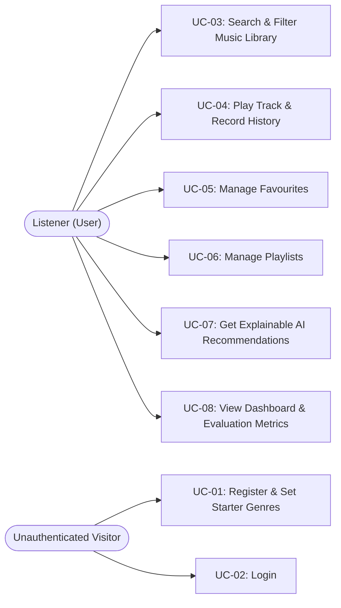

# Use Cases & Behavioral Specification — TuneTrail

## 1. Use-Case Diagram

## 2. Detailed Use Cases

- **UC-01 Register:** Visitor provides username, email, password (>= 6 chars), and optional starter genres (`UserPreferences`) to mitigate cold-start.
- **UC-02 Login:** Visitor authenticates with username/email + password and receives a signed token + HTTP session.
- **UC-03 Search & Filter Library:** Listener queries `/api/tracks` by `q`, `genre`, `artist`, and `sort`.
- **UC-04 Play Track:** Clicking Play triggers `POST /api/history`, updates the persistent bottom `PlayerBar`, and refreshes the AI taste profile.
- **UC-05 Manage Favourites:** Listener toggles heart icon (`POST /api/favourites` or `DELETE /api/favourites/<id>`), weighting those tracks 2.0x in Content-Based & Collaborative models.
- **UC-06 Manage Playlists:** Listener creates playlists, adds tracks via native `<dialog>` modal, removes tracks, or deletes playlists.
- **UC-07 AI Recommendations:** Listener switches between `Hybrid`, `Content-Based`, and `Collaborative` modes, tunes `α`, toggles "Avoid recently played", and inspects per-track explanations.
- **UC-08 Dashboard & QA:** Listener views KPIs, genre distribution, listening activity, and offline Hit Rate@10 metrics.
